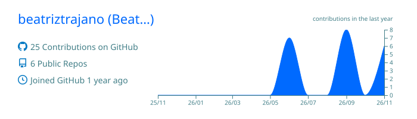
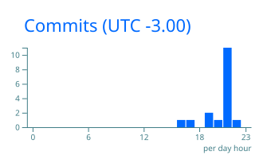

          
<!-- =====================================================
     BEATRIZ TRAJANO | GITHUB PROFILE
     Theme: Pastel Pixel Developer
     Colors: Purple / Lilac / Baby Blue / Pastel Yellow
====================================================== -->

<!-- HEADER -->
<div align="center">


<br/>


</div>

---

<!-- INTRODUCTION -->

<div align="center">

## 🐈 Welcome to my little corner of GitHub!

**Código, criatividade e curiosidade em constante evolução.**

*Code, creativity and curiosity in constant evolution.*

</div>

<!-- PIXEL CAT -->
<div align="center">

```text
                              /\_/\
                                        ( o.o )     . . .
                                              > ^ <   [ CODE MODE ]
                              /|   |\
                              (_|   |_)
```

<div align="center">


</div>

</div>

---

<!-- ABOUT ME -->

## 💜 About Me | Sobre mim


Olá! Sou estudante de **Ciência da Computação na Universidade Veiga de Almeida (UVA)** e tenho interesse em explorar como a tecnologia pode transformar ideias em soluções práticas.

Hello! I'm a **Computer Science undergraduate at Universidade Veiga de Almeida (UVA)**, interested in exploring how technology can turn ideas into practical solutions.

- 🎓 Ciência da Computação | Computer Science
- 🔬 Iniciação Científica no Observatório Nacional (ON/MCTI)
- 🤖 Interesse em robótica, eletrônica e automação
- 💻 Desenvolvimento de software e programação
- 📊 Análise de dados e bancos de dados

<br clear="right"/>

---

<!-- PROFESSIONAL EXPERIENCE -->

## 🔬 Experience & Research | Experiência

<table>
<tr>
<td width="50%" valign="top">

### 🔭 Observatório Nacional

**Scientific Initiation | Iniciação Científica**

Participação no desenvolvimento de um sistema automatizado para simulação controlada da combustão de cigarros e coleta de partículas destinadas à caracterização magnética.

*Development of an automated system for controlled cigarette combustion simulation and particle collection for subsequent magnetic characterization.*

**Areas:** Arduino, Electronics, Automation, Instrumentation.

</td>
<td width="50%" valign="top">

### 🤖 School Tech

**Project Assistant | Auxiliar de Projeto**

Experiência com tecnologia educacional, robótica, inspeção de equipamentos e capacitação de professores em atividades de programação.

*Experience with educational technology, robotics, equipment inspection and programming training.*

**Areas:** Educational Robotics, Scratch, JavaScript, HTML and CSS.

</td>
</tr>
</table>

---

<!-- AREAS OF INTEREST -->

<div align="center">

## 🌷 Areas of Interest | Áreas de interesse

</div>

<table align="center">
<tr>
<td align="center" width="25%">
<br/>
💻
<br/><b>Software</b>
<br/><sub>Development</sub>
<br/><br/>
</td>
<td align="center" width="25%">
<br/>
🤖
<br/><b>Robotics</b>
<br/><sub>Automation</sub>
<br/><br/>
</td>
<td align="center" width="25%">
<br/>
📊
<br/><b>Data</b>
<br/><sub>Analysis</sub>
<br/><br/>
</td>
</table>

---

<!-- PROJECTS -->

## 🧩 Projects | Projetos em destaque

*Some projects, experiments and academic explorations.*

<table>
<tr>
<td width="50%" valign="top">

### 🔬 Automated Combustion System

Desenvolvimento de um equipamento automatizado utilizando Arduino, motores de passo, servomotores e componentes mecânicos.

*Automated experimental instrumentation using Arduino and mechanical systems.*

`Arduino` `C/C++` `Electronics` `Automation`

</td>
<td width="50%" valign="top">

### 📊 Sample Inventory Management

Organização de um banco de amostras com cálculos automatizados, controle de disponibilidade e painéis de acompanhamento.

*Sample inventory management with automated calculations and dashboards.*

`Google Sheets` `Data Organization`

</td>
</tr>
<tr>

<td width="50%" valign="top">

### 💻 Programming & Academic Projects

Exercícios e projetos acadêmicos envolvendo lógica de programação, orientação a objetos e desenvolvimento de software.

*Academic projects involving algorithms, object-oriented programming and software development.*

`Java` `Python` `JavaScript`

</td>
</tr>
</table>

---

<!-- TECHNOLOGIES -->

<div align="center">

## 💻 Tech Stack | Tecnologias

*Technologies I've worked with and tools I'm exploring.*

### Programming Languages


### Tools & Development


### Data & Scientific Computing


</div>

---

<!-- GITHUB STATS -->

<div align="center">

## 📈 GitHub Statistics | Estatísticas




<br/>


</div>

---

<!-- CONTRIBUTION GRAPH -->

<div align="center">

## 🌱 Contribution Garden | Jardim de contribuições


</div>

---

<!-- CONTACT -->

<div align="center">

## 💌 Let's Connect! | Vamos nos conectar!

*Technology grows when knowledge is shared.*

<a href="https://github.com/beatriztrajano">

</a>

<a href="https://www.linkedin.com/">

</a>

<br/><br/>

**Obrigada pela visita! | Thanks for stopping by!**

<sub>Made with 💜, curiosity and a little bit of cat magic.</sub>

<br/>


</div>
